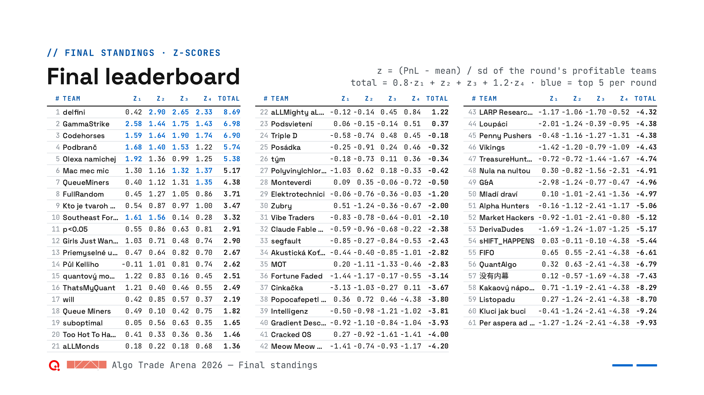
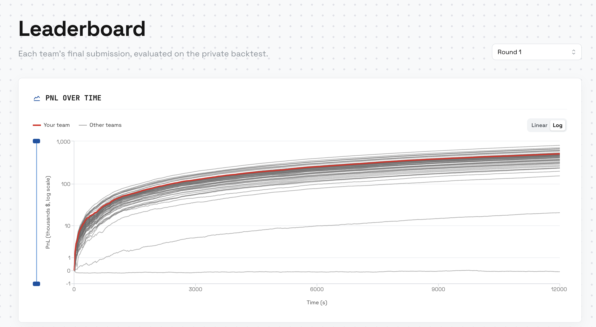
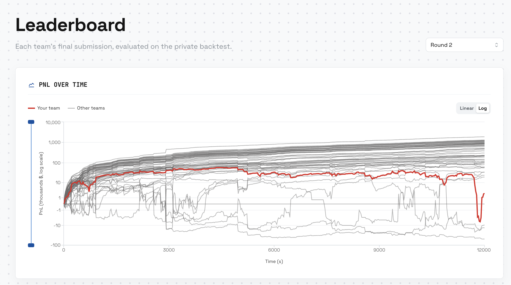
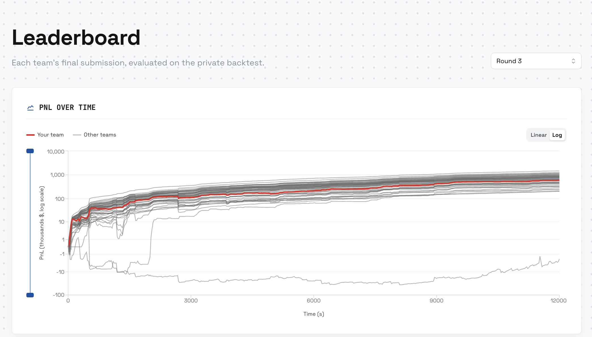
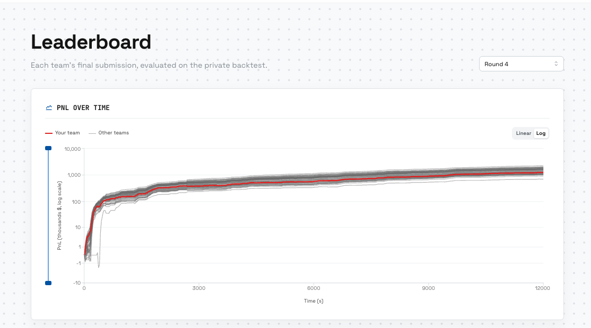

# Zubry · Qminers Algo Trade Arena 2026

Team **Zubry** (Jakub, Maciej, Paweł, Łukasz) at the
[Qminers Algo Trade Arena](https://github.com/QminersOrg/qminers-algo-arena), 7–8 November 2026.

- **The market:** one anonymised instrument, replayed from order-book tapes.
- **The rules:** orders take 5 ms to arrive, there are no fees, and every second with |inventory| > 100
  costs $10,000.
- **The rounds:** a playground, then four rounds of five hours each. Each round we submitted one
  Python file, and it was scored on an unseen private tape.

## Results

| Round (weight) | Our private PnL | Rank | Teams we beat | Median | Winner |
|---|--:|:-:|---|--:|---|
| Playground | +10,798 | 26 / 52 | `█████░░░░░` 51% | 10k | ThatsMyQuant 292k |
| Round 1 (×0.8) | **+504,903** | **14 / 61** | `████████░░` 78% | 447k | GammaStrike 793k |
| Round 2 (×1.0) | +2,281 | 55 / 59 | `█░░░░░░░░░` 7% | 441k | delfini 1.88M |
| Round 3 (×1.0) | **+589,202** | 34 / 53 | `████░░░░░░` 37% | 725k | delfini 1.46M |
| Round 4 (×1.2) | **+1,250,605** | 37 / 52 | `███░░░░░░░` 29% | 1.54M | delfini 2.26M |

**Final standing: #30 of 61**, with a weighted z-score of −2.00 (z₁ +0.51, z₂ −1.24, z₃ −0.36,
z₄ −0.67). The champion was delfini (8.69), ahead of GammaStrike (6.98) and Codehorses (6.90).
- **How it's scored:** z = (PnL − mean) / sd, taken over each round's profitable teams. The total is
  0.8·z₁ + z₂ + z₃ + 1.2·z₄.
- **Where the points went:** Round 1 was in the top quarter (+0.51). A near-zero Round 2 (−1.24) and a
  below-median Round 4 (−0.67, weighted ×1.2) pulled the total down.



| Round 1 | Round 2 |
|:-:|:-:|
|  |  |
| **Round 3** | **Round 4** |
|  |  |

*Private-tape PnL of every team over time; ours is the red line.* More:
[final leaderboard (PDF)](docs/results/arena-final-leaderboard.pdf) ·
[PnL per round](docs/results/final-pnl-per-round.png) ·
[where every team finished, rounds 1–3](docs/results/private-distribution-r1-r3.png)

## The story

**Playground: learning the machine.** We reproduced the official example exactly (1,878 PnL,
305 fills) and learned how the latency and inventory penalty behave. We finished mid-table:
+10,798, 26th of 52.

**Round 1: the queue is the edge.** We built a passive market maker. It topped up its place in the
queue, priced quotes with a ridge forecast and kept inventory within ±100. After 185 official
replays, Maciej's 8-slot variant scored 505,225 on the public tape and **504,903 on private**. That
made 14th of 61, our best round.

**Round 2: the market flipped.** Our Round 1 final lost 143k on the new tape: it traded as much as
before, but its fills were worse. We kept repairing market makers instead of studying the new market
again. The final grid maker showed 80,993 on validation. A sharp drop in the last minutes left it at
**+2,281 on private**: 55th of 59.

**Round 3: from maker to taker.** A probe of the old maker lost 659,826 on validation, so we switched
sides. The new strategy was an informed-flow follower. It holds ±100 and flips with IOC orders on
sweeps and taker flow, and a ridge model has to agree before it flips. Paweł's variant finished at
**+589,202**, 34th of 53. We had assumed the 1M+ scores were overfit; the private board showed they
were real.

**Round 4: simple beat stacked.** We added new triggers (placement class, jump onset, CUSUM,
bursts). They won on the public tape but shrank about 6× on validation. The best of our 11 uploads
was Paweł's simpler file: the follower plus a JumpBurst flip trigger we had shelved in Round 3. It
scored 1,420,312 on validation and **1,250,605 on private**: 37th of 52.

## What we learned

1. **Net executed PnL is the only score.** Not AUC, R², fill counts or a nicer forecast.
2. **Study every new tape before reusing the last winner.** Our Round 1 final lost 143k on Round 2.
3. **Validate on the server early.** Gains picked on the public tape shrank about 6× on
   validation.
4. **Take the leaderboard seriously.** If others earn twice as much on an unseen tape, the edge is
   real. Go and find it.
5. **Avoid the zero round.** Under z-scoring, our near-zero Round 2 (−1.24) cost three times what
   our best round gained (+0.41).
6. **Simple, re-tested ideas beat stacks.** Triggers that react to the same moves don't add up.
   Re-test rejected ideas on new data.

## After the competition: the hidden data

The organisers released every round's validation and private tapes, plus the hidden fair price and
the regime timings. They are stored in [`data/market_data/`](data/market_data).

- **Our scores reproduce to the dollar.** Replaying our finals on the released tapes gives all eight
  official validation and private scores exactly. It also confirms that Paweł's `r3_final.py` was our
  Round 3 final.
- **Round 1 had a single regime.** The fair price was a driftless random walk: about 7.8 independent
  moves per second, with an sd of 0.31 ticks.
- **Rounds 2–4 switched between regimes:** a calm base, turbulent spells of about 40–55 s, and
  bursts.
  - Every burst opened with a jump within 50 ms (median 22–36 ticks per tape).
  - Every burst came straight after a 3-second "thinning" lull, in which the fair price barely moved.
  - Round 4 added slow one-way "meta" drifts of about 19 s.
- **What it means for us:** the burst precursor we hunted for in Round 4 really existed. The next
  experiment is to check whether the visible order book shows that lull live
  ([notes](knowledge/round_4/dataathletechamp/data-release-fair-price-regimes.md)).

## Submissions

Server score is the score shown before the deadline. In the Playground and Round 1 that was the
public tape; from Round 2 on it was a server-only validation tape.

| Round | Uploads | Final (portal ID) | Server score | Private |
|---|:-:|---|--:|--:|
| Playground | 4 | Jakub's upload (`36dc4d98`) | 10,395 | +10,798 |
| Round 1 | 4 | Maciej's 8-slot ridge queue maker (`3a7bca12`) | 505,225 | +504,903 |
| Round 2 | 13 (1 failed) | Maciej's EMA grid maker (`0d85d5f8`) | 80,993 | +2,281 |
| Round 3 | 9 | Paweł's `r3_final.py` (`db1805cd`) | 597,854 | +589,202 |
| Round 4 | 11 of 15 (1 canceled) | Paweł's `r3_final.py` (`71380109`) | 1,420,312 | +1,250,605 |

<details>
<summary><b>Every upload, round by round</b></summary>

**Playground**, public tape

| Time | By | Score | Note |
|---|---|--:|---|
| 11:24 | Maciej | −28,717 | |
| 11:53 | Jakub | −14,125 | |
| 11:57 | Maciej | +3,582 | |
| 11:59 | Jakub | **+10,395** | **Final** → private +10,798 |

**Round 1**, public tape

| Time | By | Score | Note |
|---|---|--:|---|
| 15:24 | Jakub | 344,438 | ridge-size queue hybrid |
| 17:21 | Jakub | 477,516 | 0.5 s forecast sets the quote price |
| 17:41 | Maciej | 496,928 | ridge maker, earlier variant |
| 17:43 | Maciej | **505,225** | **Final**: 8 slots, skew 0.001 → private 504,903 |

**Round 2**, validation tape

| Time | By | Score | Note |
|---|---|--:|---|
| 21:32 | Łukasz | −10,781 | |
| 21:40 | Jakub | −229,513 | risk-aware ridge maker |
| 21:42 | Maciej | failed | rejected by the static check |
| 21:47 | Maciej | 28,827 | grid maker |
| 21:59 | Maciej | 15,917 | |
| 22:51 | Łukasz | −12,502 | |
| 23:13 | Jakub | 43,782 | queue top-ups plus size protection |
| 23:24 | Łukasz | −16,649 | |
| 23:51 | Jakub | 47,150 | EMA maker updated only on clean books |
| 23:59 | Łukasz | 51,266 | |
| 00:02 | Paweł | 37,868 | |
| 00:08 | Maciej | **80,993** | **Final**: one-price grid, 8 orders per side, EMA trend target → private 2,281 |
| 00:11 | Jakub | 41,113 | |

**Round 3**, validation tape

| Time | By | Score | Note |
|---|---|--:|---|
| 02:33 | Jakub | 272,176 | U1 informed-flow follower |
| 02:39 | Jakub | −659,826 | U2 probe: the Round 1 maker |
| 02:45 | Jakub | 258,688 | U3 regime gate plus maker |
| 03:26 | Jakub | 411,302 | U4 ridge flip gate plus 3-tick sweep trigger |
| 03:59 | Jakub | 415,828 | U6 gate refitted on R3 + R2 |
| 04:06 | Maciej | 154,162 | |
| 04:18 | Jakub | 538,844 | U7 plus taker-flow and deep-insert triggers |
| 05:23 | Paweł | **597,854** | **Final** `r3_final.py` → private 589,202 |
| 05:46 | Paweł | 596,419 | |

**Round 4**, validation tape

| Time | By | Score | Note |
|---|---|--:|---|
| 07:20 | Jakub | 1,326,712 | U1: the Round 3 follower U7 |
| 08:58 | Jakub | 1,343,784 | U2: plus the TRIG2 placement trigger |
| 10:23 | Jakub | 1,343,238 | U6: plus a jump-onset flip and a burst |
| 10:52 | Maciej | 1,250,479 | `continuous_book_adaptive.py` |
| 10:58 | Jakub | canceled | U6 re-upload |
| 11:16 | Jakub | 1,318,169 | U8 all-in: CUSUM plus a 500-lot burst |
| 11:25 | Maciej | 1,170,758 | `continuous_book_adaptive_direct_flip_edge_1_5.py` |
| 11:37 | Łukasz | 1,196,226 | `toxflow_v5.py` |
| 11:40 | Paweł | **1,420,312** | **Final** `r3_final.py`: follower plus JumpBurst flip → private 1,250,605 |
| 11:49 | Jakub | 1,400,890 | U9: U6 plus the burst flip trigger |
| 11:51 | Łukasz | 1,268,596 | `toxflow_v6.py` |

</details>

## Repository

| Path | What's there |
|---|---|
| [`knowledge/`](knowledge) | Curated notes by round and owner. Start with the retrospectives: [R1](knowledge/round_1/dataathletechamp/round1-retrospective.md) · [R2](knowledge/round_2/dataathletechamp/round2-retrospective.md) · [R3](knowledge/round_3/dataathletechamp/round3-retrospective.md) · [R4](knowledge/round_4/dataathletechamp/round4-retrospective.md) |
| [`strategies/`](strategies) | Retained single-file strategies. See the [Round 4 registry](strategies/round_4/dataathletechamp/README.md). |
| [`submissions/`](submissions) | Frozen final bundles and evidence |
| `simulator/`, `explorer/` | The organisers' exchange simulator and backtest explorer, unchanged |
| `tools/`, `tests/`, `docs/` | Team tooling, checks and procedures |
| [`data/`](data) | Public tapes and the organisers' [post-competition release](data/market_data) (validation and private tapes, fair price, regimes), as `.csv.gz` with hashes; raw CSVs are git-ignored |
| `experiments/` | Local trials and outputs, git-ignored |

**Quick start.** These commands replay our Round 4 final on the Round 4 public tape:

```bash
uv sync --locked
uv run --locked python -m gzip -d data/round4/round4_public.csv.gz
uv run --locked exchange-simulator --strategy strategies/round_4/dataathletechamp/r4_final_pawel_r3_final.py \
  --backtest data/round4/round4_public.csv --log-dir logs/r4-final --no-logs
```

Expect a PnL of 860,599 with no penalty, in about a minute.

- **API, matching, latency and scoring:** the [organiser's starter guide](docs/human/STARTER_GUIDE.md).
- **Team rules:** [TEAM_START.md](TEAM_START.md) and [AGENTS.md](AGENTS.md).
