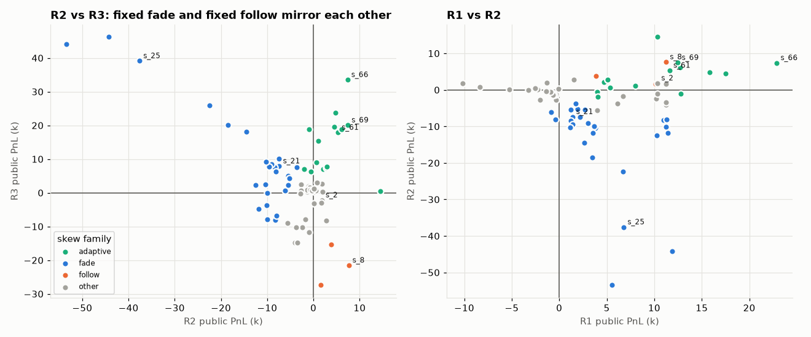
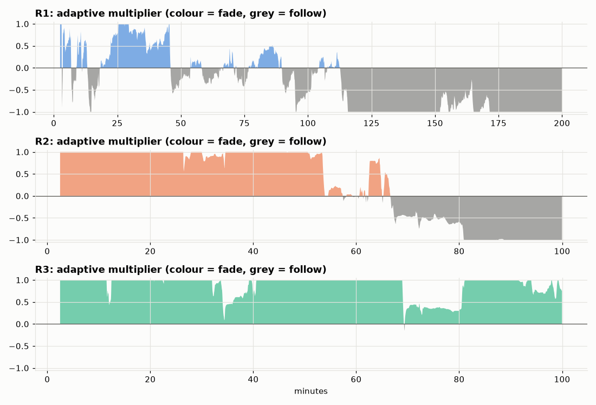
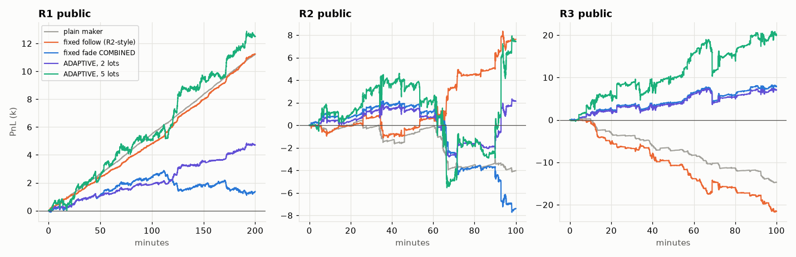

# Runda 3: drabinka 73 strategii zbudowanych na analizie taśmy

Badanie z 2026-11-08, gałąź `round3-luklen123-tape-analysis`. Punktem wyjścia była
[analiza publicznej taśmy R3](round3-public-tape-analysis.md). Każdy mechanizm z tej notatki
(i jego przeciwieństwo) dostał osobną strategię `s_{i}.py` i został przetestowany w oficjalnym
symulatorze na publicznej taśmie R3, a potem dla odporności na publicznych taśmach R1 i R2.
Wszystkie wyniki są in-sample na publicznych ścieżkach. Wynik prywatny może być inny,
co dobrze pokazała runda 2. Wykresy są w [`r3-strategy-ladder/`](r3-strategy-ladder/).

**W skrócie:** stały kierunek skew (fade albo follow) to zakład na reżim rynku. Fade wygrywa
R3 i przegrywa R2 mniej więcej tyle samo, a follow odwrotnie. Jedyna rodzina dodatnia na
**wszystkich trzech** taśmach to **adaptacyjny maker**: sam mierzy z opóźnieniem (bez
patrzenia w przyszłość), czy jego sygnał ostatnio przewidywał odwrócenie, czy kontynuację,
i według tego ustawia kierunek. Najlepsze warianty: **s_69, s_68, s_61** (5 lotów) i **s_66**
(10 lotów, ale z inwentarzem przy limicie).

## 1. Co zostało zbudowane

Wszystkie strategie pochodzą z jednego sparametryzowanego silnika (`engine_template.py`). Każdy
plik `s_{i}.py` to samodzielna strategia z jedną klasą `BaseStrategy`, bez importów zespołowych,
plików ani sieci. Lokalny preflight przechodzi; walidacja serwerowa jest nadal potrzebna.
Wspólny szkielet pochodzi z `s1.py` z rundy 2 (ledger zleceń, jedna kwota na stronę, limit
inwentarza liczony z IOC w locie).

| Mechanizm (parametr) | Skąd w analizie | Co robi |
|---|---|---|
| Skew MA (`MR_K`, `MR_TAU_S`) | rozdz. 5: cena wraca do średniej po 10–60 s | przesuwa środek kwot o `MR_K × (mid − EMA)`; > 0 pod ruch (fade), < 0 z ruchem (follow) |
| Skew flow (`FLOW_K`, `FLOW_TAU_S`) | rozdz. 5: flow z 5–30 s jest kontrariański | przesuwa środek o `FLOW_K × EMA` netto wolumenu agresorów (lotów/s) |
| Cooldown po sweepie (`BIG_TAKER`, `COOLDOWN_S`) | rozdz. 6: fill przy dużym agresorze traci 1,6 ticka po 1 s | zdejmuje trafioną stronę na kilka sekund |
| Obrona QI (`QI_RATIO`) | rozdz. 5: cienka strona zaraz spada o 0,5 ticka | nie kwotuje strony, której kolejka jest za płytka |
| Bramka spreadu / zmienności (`SPREAD_MAX`, `VOL_MAX`) | rozdz. 4 | nie kwotuje przy szerokim spreadzie / dużej zmienności z 60 s |
| Rozładowanie (`UNWIND_S`) | rozdz. 6: przewaga trwa ok. 30 s | zamyka IOC inwentarz trzymany dłużej niż T |
| Taker MR / flow / sweep (`TAKER_MODE`) | rozdz. 5–7 | IOC pod ruch / za ruchem, trzymanie H sekund |
| **Adaptacyjny znak** (`ADAPT_TAU_S`, `ADAPT_H_S`, `ADAPT_SCALE`) | wniosek z rund 1–2 drabinki | uczy się online `corr(skew_t, Δmid_{t→t+30 s})` z wagą wykładniczą i mnoży skew przez `clip(−corr/scale, −1, 1)` |

„COMBINED” w tabelach to: skew MA 0,06 (EMA 45 s) + skew flow 0,004 (tau 10 s) + cooldown po
sweepie ≥ 500 lotów (1,5 s) + QI 0,2 + spread ≤ 2. Strategie mają domyślnie 2 loty i max 20.

## 2. Jak przebiegało testowanie (4 rundy, nic nie odrzucone bez testu)

1. **s_1–s_44, R3:** kontrole, każdy mechanizm osobno w obu kierunkach, COMBINED z wariantami
   rozmiaru i umieszczenia, takery.
2. **s_45–s_54, R3:** ablacja COMBINED i rozmiary. Wszystkie s_1–s_54 dodatkowo na R2 i R1.
   Wynik: zwierciadło R2 ↔ R3 (rozdz. 3).
3. **s_55–s_65, R1/R2/R3:** adaptacyjny znak i większe takery „sweep follow”.
4. **s_66–s_73, R1/R2/R3:** rozmiar, tau, horyzont uczenia, ablacja wokół adaptacyjnego s_61.

Razem 73 strategie i 219 przebiegów symulatora: **0 błędów, 0 kar za inwentarz**.

## 3. Najważniejszy wynik: stały kierunek skew to zakład na reżim



Mediany PnL według rodziny skew:

| Rodzina | Liczba | R1 | R2 | R3 |
|---|---:|---:|---:|---:|
| **adaptive** (znak uczony online) | 15 | +10 345 | **+2 872** | **+15 434** |
| fade (stały skew pod ruch) | 27 | +3 014 | −9 944 | +6 259 |
| follow (stały skew z ruchem, jak w R2) | 3 | +10 134 | +3 809 | −21 550 |
| inne (bez skew: kontrole, filtry, takery) | 28 | −576 | −938 | +260 |

- Stały fade: im większy rozmiar, tym większy zysk na R3 i większa strata na R2 (s_25: R3
  +39,1k, R2 −37,6k; s_54: +46,3k / −44,2k). Na wykresie to niebieska przekątna.
- Stały follow (s_8, s_11, s_30) wygrywa R1/R2 i przegrywa R3 (do −27,4k).
- Same filtry obronne (cooldown, QI, bramki) nie ratują makera na R3 (−8k do −15k).
- Prosty maker bez skew (s_1) zarabia na spokojnym R1 (+11,2k), a na R3 traci (−14,7k).

## 4. Dlaczego adaptacja działa



Odtworzenie mnożnika offline (siatka 1 s, te same wzory co w s_55/s_61, tylko pary z już
znanym wynikiem):

| Taśma | Fade (mnożnik > 0,25) | Follow (< −0,25) | Prawie wyłączony |
|---|---:|---:|---:|
| R1 | 20% czasu | 57% | 23% |
| R2 | 55% | 33% | 12% |
| R3 | **97%** | 0% | 3% |

Na R3 strategia prawie cały czas jest w trybie fade. Na R2 robi fade przez pierwsze ~55 min,
a po krachu w ~60. minucie sama przełącza się na follow i trzyma go do końca. To dokładnie ten
fragment, na którym stały fade tracił. Na R1 w drugiej połowie przeważa follow.



**Zastrzeżenie dotyczące R2:** adaptacyjny 5-lotowy przechodzi przez krach ze spadkiem do ok.
−5k i wychodzi na +7,4k dopiero dzięki ruchowi ok. 92. minuty. Uczenie ma opóźnienie ok.
30 s + tau, więc **pierwsze minuty nowego reżimu zawsze idą w złą stronę**. Wynik R2 jest
dodatni, ale kruchy.

## 5. Ablacja i wrażliwość

| Zmiana (od COMBINED / adaptive) | Wniosek |
|---|---|
| bez skew flow (s_46) | R3 spada z 7,9k do 2,3k: **flow to główny sygnał na R3** |
| bez skew MA (s_45) | R3 7,6k (prawie bez zmian), R2 mniej strat: MA dodaje głównie ryzyko |
| bez QI (s_48, s_72) | R3 lepiej (+10,2k; +23,7k), R2 podobnie: QI raczej szkodzi |
| bez cooldownu po sweepie (s_47) | R3 +8,5k vs 7,9k: cooldown neutralny / lekko szkodzi |
| kwota 1 tick za touchem (s_22) | prawie zero fill: zabija zysk |
| rozładowanie po 10 s (s_27) | psuje wynik; po 30 s (s_26, s_73) neutralnie lub gorzej |
| uczenie na horyzoncie 10 s (s_70) | R2 ujemne: za krótki horyzont |
| uczenie na horyzoncie 60 s (s_71) | R3 tylko +0,4k (R2 +14,5k): za długi dla R3 |
| tau uczenia 600 / 1200 / 2400 s (s_56 / s_55 / s_57) | 600 s za nerwowe (R2 −0,5k); 1200–2400 s stabilne |
| rozmiar 2 → 5 → 10 lotów (s_55 → s_61 → s_66) | zysk rośnie prawie liniowo; przy 10/max 100 inwentarz q95 = 100 |

Takery: MR i flow fade dają małe plusy na R3 i straty na R1/R2. Sweep follow jest dodatni na
R2 i R3, ale przy większym rozmiarze traci na R1 (s_62: −10,2k). Żaden taker nie jest
kandydatem na finał.

## 6. Kandydaci

| Strategia | R1 | R2 | R3 | pnl_se R2 / R3 | Inwentarz q95 | Uwagi |
|---|---:|---:|---:|---:|---:|---|
| **s_69** adaptive, 5 lotów, prawie binarny znak | +12 493 | +7 438 | +20 047 | 9 484 / 11 267 | 50 | najlepszy minimum z 3 taśm |
| **s_68** adaptive, 5 lotów, tau 2400 s | +12 717 | +6 156 | +18 810 | 9 243 / 11 021 | 50 | |
| **s_61** adaptive, 5 lotów | +11 613 | +5 309 | +17 866 | 9 159 / 10 881 | 50 | pierwszy, niestrojony wariant 5-lotowy |
| s_66 adaptive, 10 lotów, max 100 | +22 893 | +7 377 | +33 519 | 18 420 / 21 815 | 100 | największa suma, ale inwentarz przy limicie |
| s_55 adaptive, 2 loty (pierwszy strzał) | +4 703 | +2 142 | +7 051 | 3 644 / 4 468 | 20 | najmniejsze ryzyko |

**Pnl_se jest duże w stosunku do PnL na R2 i R3.** Jednoramienny błąd nie jest różnicą parami
ani prawdopodobieństwem wygranej. Dowodem jest spójność: dodatni wynik na 3 taśmach w 12 z 15
wariantów adaptacyjnych przy różnych parametrach (ujemne na R2 są tylko s_56 z tau 600 s, s_60
bez skew MA i s_70 z horyzontem 10 s), a nie istotność pojedynczego przebiegu.

Parametry s_61–s_73 były dobierane po zobaczeniu wyników s_55, więc te warianty są lekko
dopasowane do tych trzech taśm. s_55 (pierwszy strzał, bez strojenia) jest najczystszym
dowodem, że sam mechanizm działa.

## 7. Co dalej

- Zweryfikować kandydata serwerowo (sandbox) i porównać z niezmienioną kontrolą na tych samych
  danych zwrotnych. Feedback B traktować jako zużywany przy strojeniu.
- Rozważyć szybsze wykrywanie zmiany reżimu (np. dwa tau naraz albo reset przy skoku), bo
  najdroższe są pierwsze minuty po zmianie (krach w R2).
- Nie promować wariantu 10-lotowego bez ograniczenia inwentarza poniżej 100.
- Przeniesienie wybranego pliku do `strategies/round_3/luklen123/` wymaga przeglądu.

## 8. Reprodukcja

Folder eksperymentu (nieśledzony):
`experiments/round_3/luklen123/20261108-r3-strategy-ladder-001/`. Strategie: `strategies/s_{1..73}.py`,
opisy i parametry w `strategies/manifest.json`. s_1–s_54 pochodzą z szablonu v1, s_55+ z v2/v3
(dodane tylko parametry `ADAPT_*`; przy wyłączonej adaptacji zachowanie jest identyczne).

| Plik | SHA-256 |
|---|---|
| R3 / R2 / R1 dane | `1021586b…a2d15` / `88ff641e…2fb9f4` / `362e8208…735940` (pełne w notatce z analizą) |
| `engine_template.py` (v3) | `5a4a8147679ced5c27161ccbe34335c4f46f4c0a20aca2caaa03773b74d33c1a` |
| `generate.py` | `3346e63950992d58a5420bab66eb249f56b9192fc63b64637a0ebf10e3f173f6` |
| `run_matrix.py` | `a10627679b37c9d01571263e1b66da6f134f655bda3c4f02f03fbe63799e7bec` |
| `s_55.py` | `9314bca7d6632e971121aecad35248744fd4c38967241c21daa4bc919a4c657b` |
| `s_61.py` | `e811d510a847c2549aa753c837a3809f1d339521ec273af23255010f4bbc5d4a` |
| `s_66.py` | `6d7170d8e14dc0f205d7aebdd6616fd6f7856fd60b74fc638bdff2c452811600` |
| `s_69.py` | `91199a2f619179d5d47f3d8674e2f55c072c77d083d2f13ed5feb9a6d94efe16` |

```bash
X=experiments/round_3/luklen123/20261108-r3-strategy-ladder-001
uv run --locked python $X/generate.py $X/strategies           # odtwarza s_1..s_73 (szablon v3)
uv run --locked python $X/run_matrix.py $X/strategies $X/<out>/results.csv \
  r3=data/round3/round3_public.csv r2=data/round2/round2_public.csv r1=data/round1/round1.csv --jobs 8
cd $X && uv run --locked python cross_tape.py strategies/manifest.json r3/results.csv r3/results_s45_54.csv \
  r2/results.csv r1/results.csv v2/results.csv v3/results.csv
uv run --locked --with matplotlib python adapt_diag.py ../20261108-round3-public-tape-profile <img_dir>
uv run --locked --with matplotlib python charts.py <img_dir>
```

Uwaga operacyjna: pełne logi symulatora (`events.csv`, `book_deltas.csv`, `run.jsonl`) mają ok.
200 MB na przebieg i zapełniły dysk w trakcie badania. `run_matrix.py` kasuje je teraz po
każdym przebiegu i zostawia `result.json`, `pnl.csv`, `trades.csv`.

## 9. Pełna tabela (posortowana po najgorszej taśmie)

| Strategia | Opis | R1 | R2 | R3 | Min | Rodzina |
|---|---|---:|---:|---:|---:|---|
| s_69 | ADAPTIVE COMBINED, size 5, max 50, near-binary sign | +12 493 | +7 438 | +20 047 | +7 438 | adaptive |
| s_66 | ADAPTIVE COMBINED, size 10, max 100 | +22 893 | +7 377 | +33 519 | +7 377 | adaptive |
| s_68 | ADAPTIVE COMBINED, size 5, max 50, tau 2400 s | +12 717 | +6 156 | +18 810 | +6 156 | adaptive |
| s_61 | ADAPTIVE COMBINED, size 5, max 50 | +11 613 | +5 309 | +17 866 | +5 309 | adaptive |
| s_72 | ADAPTIVE COMBINED, size 5, max 50, minus QI defence | +15 820 | +4 781 | +23 693 | +4 781 | adaptive |
| s_67 | ADAPTIVE COMBINED, size 10, max 60 | +17 473 | +4 552 | +19 612 | +4 552 | adaptive |
| s_58 | ADAPTIVE COMBINED, near-binary sign (scale 0.02) | +5 109 | +2 872 | +7 829 | +2 872 | adaptive |
| s_57 | ADAPTIVE COMBINED, tau 2400 s | +5 089 | +2 769 | +7 377 | +2 769 | adaptive |
| s_55 | ADAPTIVE COMBINED: skew sign from past corr, tau 1200 s, H 30 s | +4 703 | +2 142 | +7 051 | +2 142 | adaptive |
| s_73 | ADAPTIVE COMBINED, size 5, max 50, unwind > 30 s | +7 988 | +1 044 | +15 434 | +1 044 | adaptive |
| s_59 | ADAPTIVE COMBINED, stronger base skews (MR 0.12, flow 0.008) | +5 382 | +684 | +8 950 | +684 | adaptive |
| s_71 | ADAPTIVE COMBINED, size 5, max 50, learn on 60 s horizon | +10 345 | +14 515 | +396 | +396 | adaptive |
| s_41 | taker sweep FOLLOW: taker >= 2000, hold 1 s | -103 | +230 | +220 | -103 | other |
| s_56 | ADAPTIVE COMBINED, tau 600 s | +3 983 | -520 | +6 347 | -520 | adaptive |
| s_32 | taker MR: L=60 s, /z/>=1.0, hold 30 s | -699 | -878 | +1 491 | -878 | other |
| s_38 | taker flow FADE: /flow EMA/ >= 450 lots/s, hold 30 s | -914 | -619 | +934 | -914 | other |
| s_70 | ADAPTIVE COMBINED, size 5, max 50, learn on 10 s horizon | +12 786 | -986 | +18 847 | -986 | adaptive |
| s_31 | taker MR: L=60 s, /z/>=1.0, hold 60 s, 5 lots | -670 | -1 122 | +1 992 | -1 122 | other |
| s_34 | taker MR: L=60 s, /z/>=1.5, hold 60 s | -356 | -1 230 | +280 | -1 230 | other |
| s_65 | taker sweep FOLLOW: taker >= 1500, hold 5 s, 20 lots | -1 285 | +1 959 | +240 | -1 285 | other |
| s_35 | taker MR: L=120 s, /z/>=1.0, hold 60 s | -510 | -1 329 | +365 | -1 329 | other |
| s_36 | taker MR: L=30 s, /z/>=1.0, hold 30 s | -641 | -1 338 | +890 | -1 338 | other |
| s_44 | taker sweep FADE: taker >= 1000, enter after 2 s, hold 60 s | -1 345 | -322 | +700 | -1 345 | other |
| s_60 | ADAPTIVE COMBINED minus MR (flow only) | +4 074 | -1 969 | +7 048 | -1 969 | adaptive |
| s_2 | control: R2 s1 gates (spread==1 via SPREAD_MAX=1, trailing vol60 > 3 off) | +10 339 | +1 816 | -2 203 | -2 203 | other |
| s_42 | taker sweep FOLLOW: taker >= 1000, hold 5 s | -2 514 | +487 | +710 | -2 514 | other |
| s_37 | taker flow FADE: /flow EMA/ >= 300 lots/s, hold 30 s | -2 100 | -2 618 | +621 | -2 618 | other |
| s_33 | taker MR: L=60 s, /z/>=1.0, hold 120 s | -343 | -2 731 | +2 563 | -2 731 | other |
| s_43 | taker sweep FADE: taker >= 1000, enter after 2 s, hold 30 s | -2 050 | -2 760 | -169 | -2 760 | other |
| s_20 | vol gate only (R2 idea): trailing vol60 > 3 off | +11 206 | +1 647 | -2 903 | -2 903 | other |
| s_39 | taker flow FOLLOW: /flow EMA/ >= 300 lots/s, hold 5 s | -2 266 | +162 | -3 108 | -3 108 | other |
| s_40 | taker sweep FOLLOW: taker >= 1000, hold 1 s | -3 255 | -108 | +474 | -3 255 | other |
| s_45 | COMBINED minus MR skew | +1 761 | -3 659 | +7 571 | -3 659 | fade |
| s_29 | COMBINED, stronger inventory skew 0.15 | +1 894 | -5 168 | +4 255 | -5 168 | fade |
| s_63 | taker sweep FOLLOW: taker >= 1000, hold 3 s, 10 lots | -5 273 | +127 | +1 123 | -5 273 | other |
| s_26 | COMBINED, unwind inventory held > 30 s | +1 227 | -5 404 | +4 996 | -5 404 | fade |
| s_46 | COMBINED minus flow skew | +2 713 | -5 410 | +2 286 | -5 410 | fade |
| s_27 | COMBINED, unwind inventory held > 10 s | -839 | -6 116 | +656 | -6 116 | fade |
| s_21 | COMBINED: MR fade + flow fade + sweep cooldown + QI + spread<=2 | +1 376 | -7 394 | +7 895 | -7 394 | fade |
| s_48 | COMBINED minus QI defence | +2 155 | -7 430 | +10 198 | -7 430 | fade |
| s_13 | sweep cooldown: pull hit side 1.5 s after taker >= 500 | +6 694 | -1 724 | -7 940 | -7 940 | other |
| s_7 | MR skew fade, k=0.06, tau 20 s | +11 315 | -8 048 | -6 722 | -8 048 | fade |
| s_14 | sweep cooldown: pull hit side 3 s after taker >= 300 | +1 555 | +2 816 | -8 175 | -8 175 | other |
| s_28 | COMBINED, wider half-width 1.0 | -376 | -8 180 | +6 259 | -8 180 | fade |
| s_3 | MR skew fade, k=0.03, tau 45 s | +10 954 | -8 263 | -8 138 | -8 263 | fade |
| s_64 | taker sweep FOLLOW: taker >= 700, hold 5 s, 10 lots | -8 339 | +727 | +3 101 | -8 339 | other |
| s_23 | COMBINED, keep queue priority up to 1 tick behind target | +1 224 | -8 425 | +7 626 | -8 425 | fade |
| s_17 | QI defence: pull side with best queue < 40% of other side | +4 003 | -5 596 | -8 998 | -8 998 | other |
| s_47 | COMBINED minus sweep cooldown | +3 014 | -9 038 | +8 536 | -9 038 | fade |
| s_49 | COMBINED minus spread gate | +1 388 | -9 523 | +7 769 | -9 523 | fade |
| s_12 | flow skew fade, k=0.004, tau 30 s | +3 652 | -9 944 | -7 845 | -9 944 | fade |
| s_22 | COMBINED, quote 1 tick behind touch | +1 124 | -10 048 | +7 | -10 048 | fade |
| s_4 | MR skew fade, k=0.06, tau 45 s | +11 238 | -10 153 | -3 785 | -10 153 | fade |
| s_62 | taker sweep FOLLOW: taker >= 1000, hold 5 s, 20 lots | -10 190 | +1 863 | +2 595 | -10 190 | other |
| s_15 | sweep cooldown: pull hit side 1 s after taker >= 1000 | +10 179 | -2 448 | -10 242 | -10 242 | other |
| s_50 | COMBINED with stronger skews (MR 0.12, flow 0.008) | +1 145 | -10 250 | +9 183 | -10 250 | fade |
| s_16 | QI defence: pull side with best queue < 20% of other side | +6 114 | -3 686 | -10 255 | -10 255 | other |
| s_10 | flow skew fade, k=0.008, tau 10 s | +3 827 | -10 417 | +2 553 | -10 417 | fade |
| s_19 | spread gate: quote only when spread == 1 | +10 339 | -998 | -11 615 | -11 615 | other |
| s_6 | MR skew fade, k=0.06, tau 120 s | +11 445 | -11 718 | -4 710 | -11 718 | fade |
| s_9 | flow skew fade, k=0.004/(lots/s), tau 10 s | +3 531 | -11 793 | -4 704 | -11 793 | fade |
| s_5 | MR skew fade, k=0.12, tau 45 s | +10 284 | -12 450 | +2 384 | -12 450 | fade |
| s_52 | COMBINED, size 5, max 50, unwind > 30 s | +2 616 | -14 557 | +18 036 | -14 557 | fade |
| s_1 | control: plain touch maker 2 lots, max 20, inventory skew only | +11 206 | -4 032 | -14 711 | -14 711 | other |
| s_18 | spread gate: quote only when spread <= 2 | +11 210 | -3 462 | -14 883 | -14 883 | other |
| s_30 | COMBINED but trend-following signs (control for direction) | +3 854 | +3 809 | -15 425 | -15 425 | follow |
| s_24 | COMBINED, size 5, max 50 | +3 479 | -18 493 | +20 205 | -18 493 | fade |
| s_8 | MR skew FOLLOW (R2-style trend lean), k=-0.06, tau 45 s | +11 245 | +7 625 | -21 550 | -21 550 | follow |
| s_51 | COMBINED, size 10, max 60 | +6 726 | -22 424 | +25 926 | -22 424 | fade |
| s_11 | flow skew FOLLOW, k=-0.004, tau 10 s | +10 134 | +1 630 | -27 408 | -27 408 | follow |
| s_25 | COMBINED, size 10, max 100 | +6 790 | -37 600 | +39 117 | -37 600 | fade |
| s_54 | COMBINED, size 20, max 100 | +11 888 | -44 200 | +46 256 | -44 200 | fade |
| s_53 | COMBINED, size 10, max 100, stronger skews | +5 523 | -53 478 | +44 047 | -53 478 | fade |
