# Round 3 public tape: what the market looks like and what it means for a strategy

Investigated 2026-11-08 on branch `round3-luklen123-tape-analysis`. This note describes the
R3 public tape (`round3_public.csv`) on its own and then compares it with the R1 and R2 public
tapes, using **the same book-reconstruction code and the same definitions for all three**.
Every number is an in-sample statistic of one public path. None of it is a promise about the
private tape. Charts are in [`round3-public-tape-analysis/`](round3-public-tape-analysis/).

**In one sentence:** the order generator is the same as before, but the price process has
changed again. R3 is as jumpy as R2, but where R2 *trended* after a move, R3 *overshoots for a
few seconds and then pulls back over 10–60 s*. The R2 winners (kuba, koziol, s_75, the actual
R2 Final) all **lose 33k–73k** on this tape when replayed unchanged.

---

## 1. The file

| | |
|---|---|
| Path | `data/round3/round3_public.csv` (raw, untracked, not modified) |
| Size / rows | 86 670 643 B, 2 412 805 data rows + header |
| SHA-256 | `1021586b92a3d9dfdb70096e6b0af34d460813b139f1f51f56b73871cb5a2d15` |
| Time span | 0.001095 – 5999.994333 s → **6000 s (100 min)**, same length as R2 public |
| Format | unchanged: `Time,Operation,OrderId,Side,Volume,Price,Lifespan`; `G` = resting limit, `F` = IOC |
| Integrity | time strictly increasing, no duplicate order IDs, every cancel targets a known ID |
| Cancels that do nothing | 155 141 (13%), all aimed at orders already fully filled. Same as R1/R2. |
| Prices | 9732 – 10160 ticks; mid starts 10000, ends 9872.5, min 9766, max 10131.5 |

Nothing new in the format. No new order types, no new fields. The round brief in this
workspace (`rounds/r3/BRIEF.md`) still says data/mechanic changes are "not released", so
latency (5 ms), ±100 penalty-free inventory and the liquidation-style markout are **assumed
unchanged**. Confirm with the organizers before relying on it.

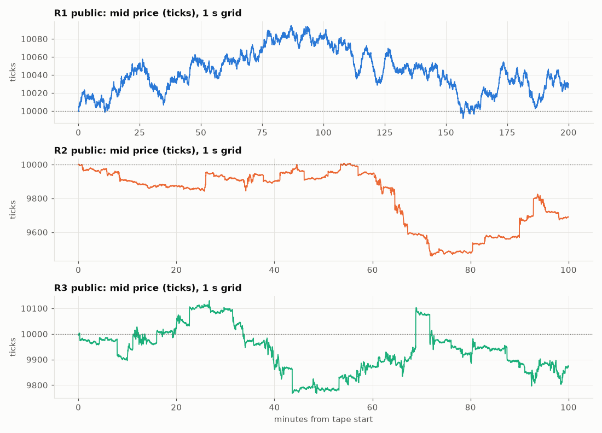

## 2. What stayed the same (the "order generator")

| | R1 (12 000 s) | R2 public | **R3 public** |
|---|---:|---:|---:|
| Book events / s | 344 | 340 | **376** (+10%) |
| Inserts / s | 188 | 187 | **206** |
| IOC share of inserts | 4.3% | 4.8% | 4.6% |
| Median insert size (lots) | 15 | 15 | **19** |
| Median resting-order lifetime | 0.31 s | 0.29 s | 0.30 s |
| Share of resting volume that fills | 8.7% | 9.0% | 8.4% |
| Aggressive orders / s | 7.9 | 8.6 | 8.8 |
| Aggressive volume / s (lots) | 1121 | 1167 | 1194 |
| Median aggressive order (lots) | 60 | 58 | 57 |
| Buy share of aggressive volume | 50.1% | 49.7% | 49.1% |
| Where new resting orders join (at best / 1 behind / 2 behind) | not measured | 49% / 34% / 7% | 44% / 31% / 11% |

Event intensity is ~10% higher and orders are a bit bigger, but this is the same family of
flow. The book is still never crossed or locked. Being 5 ms late still means several market
events go by before our order arrives (median gap between events 1.6 ms).

## 3. What changed: thinner book, more one-tick churn

| | R1 | R2 | **R3** |
|---|---:|---:|---:|
| Spread = 1 tick (share of time) | 93.0% | 83.9% | **81.6%** |
| Spread = 2 / 3 / ≥4 ticks | 6.9% / 0.1% / 0.0% | 11.6% / 3.1% / 1.4% | 14.0% / 3.2% / 1.2% |
| Median lots at best bid | 921 | 713 | **540** |
| 10th percentile lots at best bid | 100 | 55 | **37** |
| Mid changes per second | 2.6 | 4.9 | **5.8** |
| Sign autocorrelation of consecutive mid changes | +0.07 | +0.24 | **+0.35** |
| Time without a two-sided book | 1.6 s | 4.1 s | 2.0 s |

The best-price queue is about **25% shallower than R2 and 40% shallower than R1**. The mid
moves more often, and consecutive mid ticks go in the same direction more often (+0.35).
Price moves in small runs instead of bouncing back and forth.

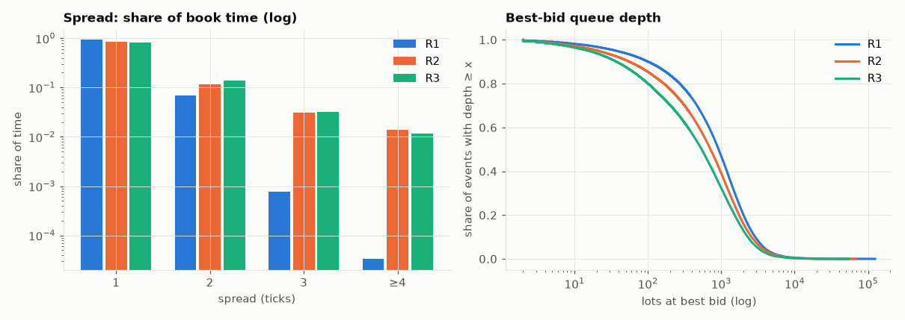

## 4. Volatility and jumps

| | R1 | R2 | **R3** |
|---|---:|---:|---:|
| σ of 1 s mid change (ticks) | 0.92 | 3.80 | **4.49** |
| σ of 60 s mid change | 7.3 | 31.7 | **32.2** |
| Excess kurtosis of 1 s changes | 0.6 | 232 | **214** |
| 1st / 99th percentile of 1 s change | −2 / +2 | −9.5 / +9 | **−11 / +11** |
| Largest 1 s down / up | −4 / +4 | −95.5 / +111 | **−111.5 / +122.5** |
| Seconds with \|change\| ≥ 5 / 10 / 20 ticks | 0% | 6.8% / 1.8% / 0.37% | **11.2% / 2.9% / 0.33%** |
| Share of total squared movement from \|change\| ≥ 10 | 0% | 73% | **71%** |
| Total mid range | 103 | 549 | **363** |

R3 is slightly **more volatile second-by-second** than R2 and has *more medium jumps* (5–20
ticks). It has about the same number of very large jumps. Still, the 60-second σ is almost
identical to R2's. Moves that are bigger at 1 s but no bigger at 60 s must be partly giving
themselves back (section 5). Unlike R2, there is **no single dominant crash**: the largest 60 s
moves are +192, −137, −100, −97, −92, +89, +89, −90, spread across the whole tape.

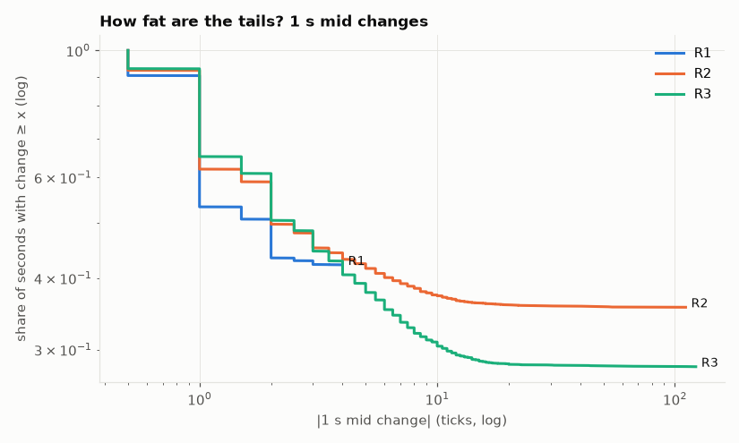

### Volatility does not cluster any more

| | R1 | R2 | **R3** |
|---|---:|---:|---:|
| corr(volatility of the last 60 s, volatility of the next 60 s) | −0.01 | **+0.15** | **−0.05** |
| Autocorrelation of \|1 s change\| at lag 1 / 10 / 60 s | ≈0 | 0.23 / 0.07 / −0.00 | 0.18 / 0.07 / −0.00 |
| Mean \|next 10 s move\| when spread = 1 / 2 / 3 / ≥4 | 2.3 / 2.4 / 2.0 | 4.7 / 10.9 / 14.2 / 29.2 | **6.7 / 12.4 / 16.5 / 32.5** |
| Mean \|next 10 s move\| by trailing-60 s-vol quartile (low → high) | flat | 4.5 → 8.8 | 6.5 → 10.2 |

In R2 a volatile minute predicted another volatile minute. That was the basis of the s1-style
"stop quoting when trailing vol is high" filter. **In R3 trailing 60 s volatility does not
predict the next 60 s at all.** Volatility is clustered only over a few seconds (lag-1 0.18,
gone by ~30 s). The **current spread** is still a good warning light: a 2-tick spread means the
next 10 s move is ~2× bigger, and ≥4 ticks means ~5× bigger. That holds in R2 and R3 alike.

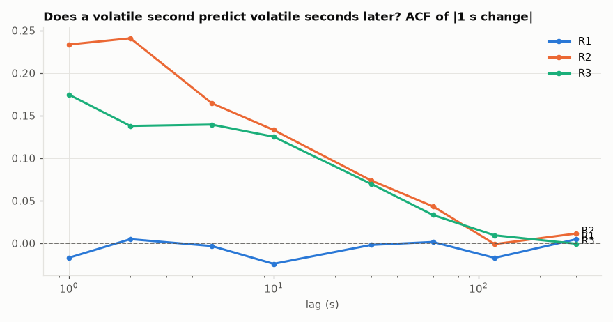
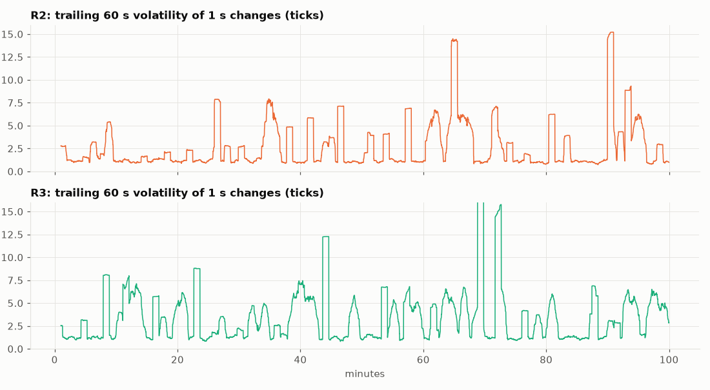

## 5. The key change: short momentum, then mean reversion

The variance ratio compares how far price travels over h seconds with what a random walk would
do. Above 1 means moves continue (trend). Below 1 means moves are partly undone.

| h (s) | 2 | 5 | 10 | 30 | 60 | 120 | 300 | 600 |
|---|---:|---:|---:|---:|---:|---:|---:|---:|
| R1 | 1.01 | 1.00 | 1.00 | 0.97 | 1.04 | 1.10 | 0.90 | 0.68 |
| R2 | 1.03 | 0.98 | 1.03 | 1.13 | 1.16 | 1.33 | 1.78 | 2.35 |
| **R3** | **1.11** | **1.19** | 1.13 | **0.91** | **0.86** | **0.86** | **0.78** | 0.90 |

- **1–5 s: momentum.** A move tends to carry on for a few seconds (1 s return lag-1
  autocorrelation +0.11, the highest of the three rounds).
- **10 s – 5 min: reversion.** Successive 10/20/30 s returns are negatively correlated
  (−0.10 / −0.11 / −0.08), and the variance ratio drops below 1.
- It holds in **both halves** of the tape: VR(10/60/300 s) = 1.12/0.87/0.89 in the first half
  and 1.15/0.85/0.71 in the second. R2 was the mirror image (trend, stronger in the second half).

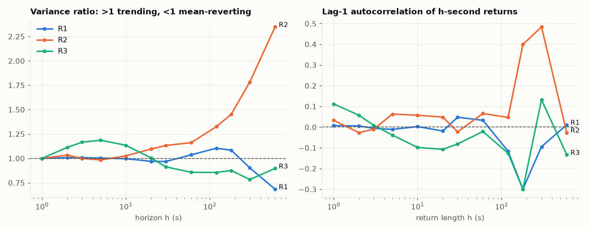

**Distance from a moving average** (L seconds) vs the next H seconds, non-overlapping samples:

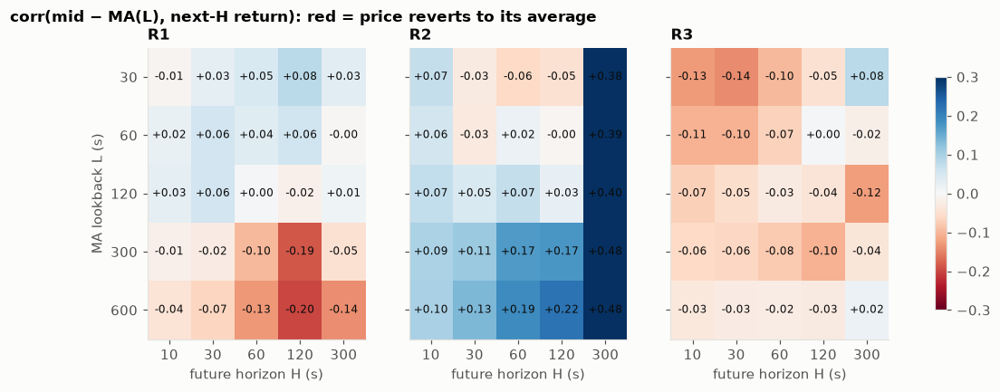

The R3 panel is red (reverting) nearly everywhere. It is strongest for a **30–60 s average and
a 10–30 s horizon** (corr −0.10 to −0.14). R2 was blue (trending). R1 reverted only at long
lookbacks (5–10 min). The R2 300 s column (+0.4) is one crash and a handful of samples, so
don't read much into it.

Stability check, one dot per 10-minute block (L = 120 s, H = 30 s):

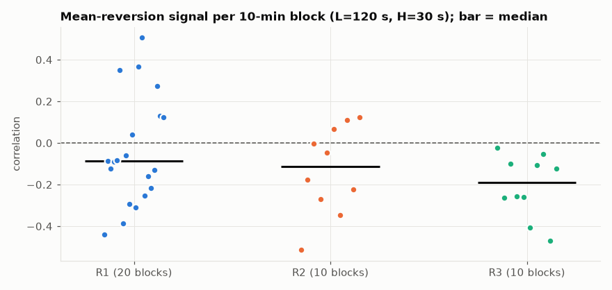

R3 is **negative in 10 of 10 blocks** (R1 13/20, R2 7/10). It is the most consistent signal on
this tape. The correlations are small (median ≈ −0.18), so it is a tilt, not a money machine.

### Order flow is now a contrarian signal

Net aggressive volume (buys − sells) over the past L seconds vs the next H seconds:

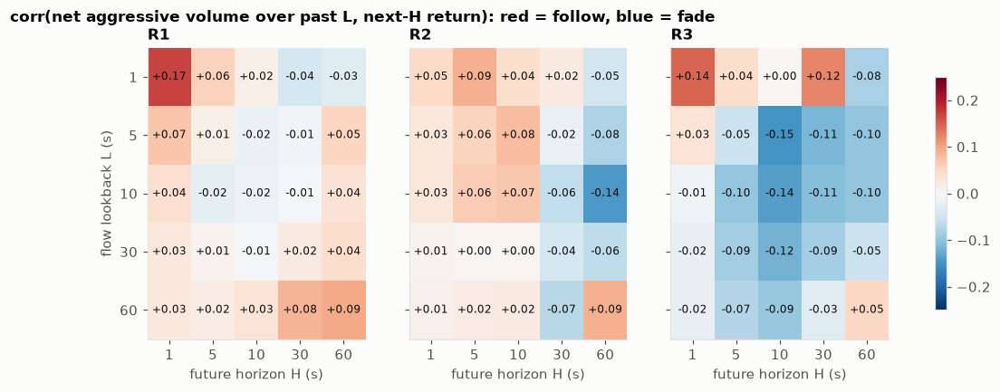

| | R1 | R2 | **R3** |
|---|---:|---:|---:|
| Past 1 s flow → next 1 s | +0.17 | +0.05 | **+0.15** |
| Past 10 s flow → next 10 s | −0.02 | +0.07 | **−0.14** |
| Past 10 s flow → next 30 s | −0.01 | −0.06 | **−0.11** |
| Blocks where 10 s flow → 30 s is negative | 10/20 | 5/10 | **9/10** |

Same story as the price: **the last second of buying predicts a bit more up-move in the next
second, but buying over the last 5–30 s predicts a down-move over the next 5–60 s.** In R2 the
5–10 s flow pointed *with* the next 5–10 s.

### Queue imbalance is back, slightly

| corr(best-level imbalance, next mid change) | 0.1 s | 0.5 s | 1 s | 5 s |
|---|---:|---:|---:|---:|
| R1 | 0.30 | 0.34 | 0.25 | 0.11 |
| R2 | 0.08 | 0.05 | 0.04 | 0.01 |
| **R3** | **0.10** | **0.09** | **0.07** | 0.02 |

Still far from R1, but better than R2. When one side has < 20% of the other side's lots, the
next 1 s move is −0.52 (thin bid) / +0.42 (thin ask) ticks. This is useful for **not resting
on the side about to be swept**, not for taking.

### After a sharp jump: no reliable answer

Event study: a 5 s move ≥ 2.5 σ, then where price goes over the next 5 min, scaled by the jump
size (shaded = 95% interval).

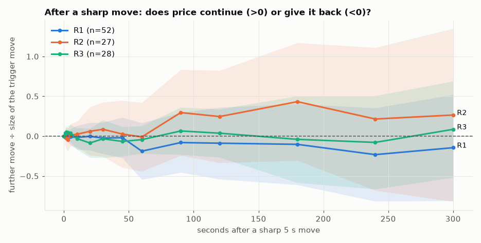

R3 keeps going for ~2 s (+1.8 ticks after a ~30-tick jump) and then gives a little back by
10–60 s. With only 28 independent jumps the intervals are wide, and the two halves of the tape
disagree at 300 s (+33 vs −30 ticks). **Do not build a "fade the crash" rule on this.** The
reliable reversion is in ordinary minutes, not specifically after jumps. Fading the largest
moves (|60 s move| ≥ 3σ, n=4) looked good in R3 but terrible in R2 (+40 ticks continuation
at 300 s).

## 6. What a passive fill is worth (maker markout)

Ticks per lot earned by the resting side of each market trade, measured against the mid h
seconds later (volume-weighted, no queue position or latency):

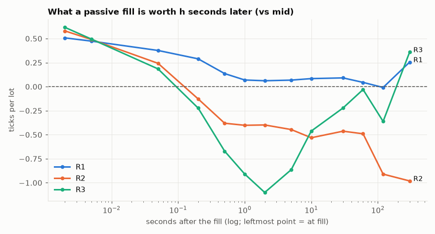

| h | 0 | 50 ms | 0.5 s | 1 s | 2 s | 10 s | 30 s | 60 s | 300 s |
|---|---:|---:|---:|---:|---:|---:|---:|---:|---:|
| R1 | +0.51 | +0.38 | +0.14 | +0.07 | +0.06 | +0.08 | +0.09 | +0.04 | +0.26 |
| R2 | +0.58 | +0.24 | −0.38 | −0.40 | −0.40 | −0.53 | −0.46 | −0.49 | −0.98 |
| **R3** | +0.62 | +0.18 | **−0.67** | **−0.91** | **−1.10** | −0.46 | −0.22 | **−0.03** | +0.36 |

R3's shape is the "overshoot then revert" pattern seen from the maker's chair. **The first
1–5 seconds after a fill are the worst of any round** (−1.1 ticks/lot at 2 s). After that the
loss recovers to about zero by 60 s. A maker who **gets out within a second loses the most**; a
maker who can sit through 30–60 s gets back most of it. In R2 the loss only grew with time.

### Who is safe to trade against

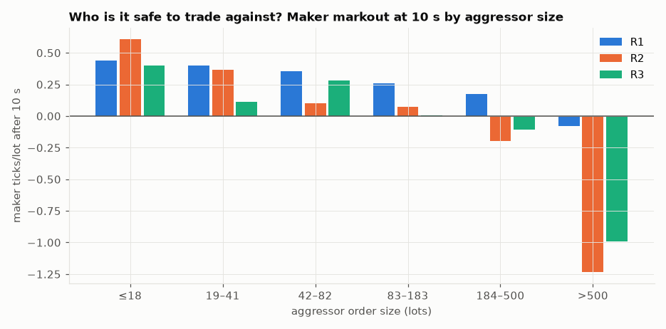

| Aggressor size (lots) | R1 10 s | R2 10 s | **R3 1 s** | **R3 10 s** | **R3 60 s** |
|---|---:|---:|---:|---:|---:|
| ≤ 18 | +0.44 | +0.61 | +0.25 | **+0.40** | +0.23 |
| 19–41 | +0.40 | +0.37 | +0.15 | +0.11 | −0.25 |
| 42–82 | +0.36 | +0.10 | +0.13 | +0.28 | +0.29 |
| 83–183 | +0.26 | +0.07 | −0.19 | +0.01 | +0.05 |
| 184–500 | +0.18 | −0.20 | −0.57 | −0.11 | **+0.55** |
| > 500 | −0.08 | −1.23 | **−1.59** | −0.99 | −0.56 |

Small aggressors are still profitable to trade against. Big ones (> 500 lots) are still toxic,
and in R3 their 1-second impact is the worst yet. Aggressor continuation measured from t+5 ms
(when we can first react) is also the strongest so far: +1.7 ticks at 1 s after 500–1000 lots
and +2.8 ticks after ≥ 1000 lots, vs +1.2 / +1.6 in R2. Since our order sits behind ~540 lots at
the best price, we mostly get filled when a big order eats through the queue. **That is
exactly the fill that hurts.**

### Does leaning against the move help?

Split the passive fills by whether the maker was buying after a 60 s fall / selling after a 60 s
rise ("against move") or the opposite ("with move"):

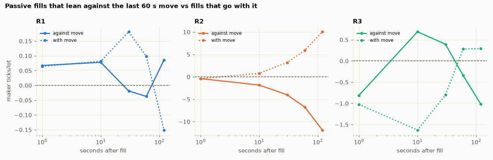

| Fill | R2 10 s | R2 60 s | **R3 1 s** | **R3 10 s** | **R3 30 s** | **R3 60 s** | **R3 120 s** |
|---|---:|---:|---:|---:|---:|---:|---:|
| against move, all sizes | −1.85 | −6.77 | −0.81 | **+0.69** | **+0.39** | −0.34 | −1.02 |
| against move, aggressor ≤ 82 | −1.30 | −6.27 | +0.22 | **+1.55** | **+0.59** | −0.63 | −1.40 |
| with move, all sizes | +0.78 | +5.89 | −1.03 | −1.63 | −0.80 | +0.28 | +0.29 |

In R2, leaning against the move was a disaster and going with it was hugely profitable (that
is why trend-skewed makers like kuba won there). **In R3 it flips over the 10–30 s window:
against-the-move fills earn +0.4 to +1.6 ticks/lot.** The edge is gone by 60–120 s, so the
reverting window is short. Inventory taken against the move should be worked off within ~30 s,
not held for minutes.

## 7. A toy taker test (sanity check, not a strategy)

Fade the deviation from an L-second average when |z| ≥ k, hold H seconds, and pay half the
spread on each side. One lot, non-overlapping trades, mid-price fills.

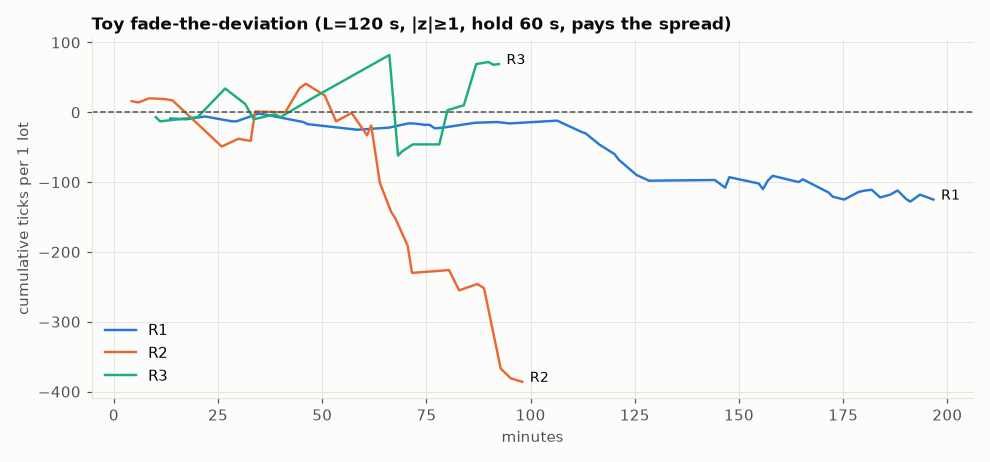

| Config (L, k, H) | R1 mean / t | R2 mean / t | **R3 mean / t** | R3 1st half / 2nd half |
|---|---:|---:|---:|---:|
| 60 s, 1.0, 30 s | −1.6 / −3.2 | −5.8 / −2.0 | **+6.4 / +1.8** | +2.9 / +10.1 |
| 60 s, 1.0, 60 s | −2.1 / −2.3 | −8.5 / −1.7 | **+12.2 / +2.8** | +12.4 / +12.0 |
| 60 s, 1.0, 120 s | −1.5 / −0.8 | −20.4 / −2.2 | **+18.6 / +2.0** | +24.6 / +12.1 |
| 120 s, 1.0, 60 s | −2.4 / −2.2 | −13.3 / −2.2 | +3.5 / +0.4 | +2.3 / +4.4 |

R3 is the only round where fading is positive after costs, in both halves, for the 60 s
lookback. R1 and R2 lose in every configuration. **But n is 27–43 trades**, so a few big jumps
decide the total. Treat this as evidence for the direction, not as a tradable taker strategy.
Crossing the spread for ±1 lot per minute is much smaller than what a maker can capture.

## 8. Our R2 strategies on the R3 public tape (official simulator)

Unchanged files, official `exchange-simulator`, R3 public tape, 5 ms latency, no penalties in
any run.

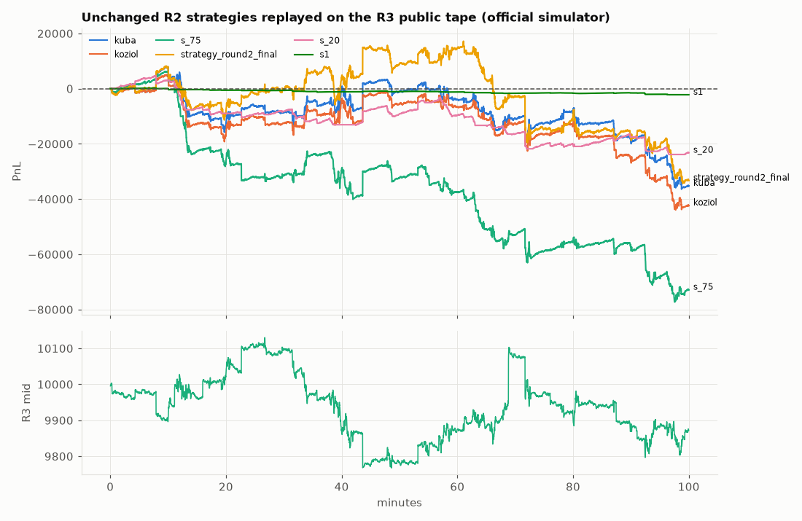

| Strategy (R2 role) | R3 public PnL | pnl_se | Fills | Lots traded | Passive markout 10 s / 60 s (ticks/lot) | Inventory q50 / q95 |
|---|---:|---:|---:|---:|---:|---:|
| kuba (R2 private +43k) | **−35 203** | 23 960 | 14 881 | 257 604 | −0.17 / −0.14 | 52 / 100 |
| koziol (R2 private +28.8k) | **−42 310** | 24 374 | 11 760 | 232 600 | −0.21 / −0.18 | 56 / 100 |
| s_75 (kuba HPO winner) | **−72 860** | 24 193 | 13 426 | 351 388 | −0.21 / −0.22 | 39 / 100 |
| strategy_round2_final (actual R2 Final) | **−33 296** | 28 910 | 24 895 | 475 076 | −0.12 / −0.07 | 100 / 100 |
| s_20 (50-lot maker) | **−23 227** | 9 768 | 7 613 | 330 671 | −0.13 / −0.06 | 14 / 46 |
| s1 (vol/spread-gated, 1-lot) | **−2 203** | 656 | 8 002 | 15 956 | −0.16 / −0.11 | 1 / 2 |

Where the money went:

- **Every strategy is almost purely passive** (≥ 99.9% of lots as maker). Their fills lose
  ~0.1–0.2 ticks per lot within 10–60 s. Multiplied by 230k–475k lots, that is the whole loss.
  This is adverse selection, not penalty or inventory blow-ups.
- **kuba/koziol lose at the same rate in calm and moving minutes** (≈ −360 / −430 per minute
  either way). s_75 and the R2 Final lose more in moving minutes. s_20 actually **makes** +287
  per calm minute and loses −597 per moving minute. Its problem is moves, not quiet time.
- The trend skew that won R2 (lean with the last move) is the wrong way round here: in R3 the
  "with-move" fills are the losing ones at 10–30 s (section 6).
- Losses are spread across most 10-minute blocks (kuba: +7.8k, −21.1k, +4.7k, +8.7k, −1.3k,
  −2.9k, −6.8k, +2.4k, −10.5k, −16.3k). They are not one bad event.

**Conclusion: none of the R2 leads is a usable R3 seed as-is.** Their quoting machinery
(queue handling, gap logic, inventory ledger) is still reusable. Their skew direction and
regime filter are tuned to the wrong market.

## 9. R3 by 10-minute block

| Block | Mid start → end | Low – high | σ 1 s | Mean spread | Median L1 bid | VR(60 s) |
|---|---|---|---:|---:|---:|---:|
| 0 | 9995.5 → 9896.5 | 9896 – 10003.5 | 3.04 | 1.10 | 722 | 0.78 |
| 1 | 9904.5 → 10025.5 | 9904.5 – 10027.5 | 4.67 | 1.34 | 413 | 0.59 |
| 2 | 10033.5 → 10099.5 | 10031 – 10130 | 3.74 | 1.16 | 651 | 0.66 |
| 3 | 10098.5 → 9869.0 | 9869 – 10099.5 | 3.89 | 1.30 | 459 | 0.84 |
| 4 | 9865.5 → 9783.5 | 9767.5 – 9919 | 5.05 | 1.22 | 554 | 0.68 |
| 5 | 9784.5 → 9874.5 | 9774.5 – 9891.5 | 3.97 | 1.25 | 593 | 0.50 |
| 6 | 9875.0 → 10081.5 | 9834 – 10103 | **6.52** | 1.38 | 421 | 0.99 |
| 7 | 10081.5 → 9911.5 | 9908 – 10081.5 | 5.39 | 1.16 | 659 | 0.55 |
| 8 | 9904.5 → 9879.5 | 9868.5 – 9980.5 | 3.13 | 1.19 | 673 | 0.65 |
| 9 | 9882.5 → 9872.5 | 9796.5 – 9902.5 | 4.31 | 1.36 | 388 | 0.89 |

The 60 s variance ratio is below 1 in **every** block, so the reversion is not driven by one
episode. Even block 6, which has the largest single move (+192 in 60 s), sits near 1, not above.
Event rates are flat across blocks (≈ 118–129k inserts per block).

## 10. What this means for an R3 strategy

Ranked by how solid the evidence is on this tape.

1. **Do not reuse R2 skew direction.** Leaning *with* the recent move was the R2 edge and is a
   loss in R3 at 10–30 s. If a skew is used, it should lean **against** the last 30–60 s move
   (or against the last 5–30 s net aggressive flow), and work the position off within ~30 s.
   Keep it behind a flag/parameter so both directions can be tested on every tape.
2. **Avoid the first seconds after a big aggressor.** Fills next to aggressors > 500 lots lose
   ~1.6 ticks/lot at 1 s. 1–5 s momentum is real (+0.11 lag-1 ACF; +2.8 ticks after ≥ 1000-lot
   takers). Pull or widen the quote on the hit side for ~1–2 s after a large sweep, and
   re-enter on the reverting side once the run stalls. In R2 the "cancel after every ≥ 200-lot
   aggressor" variant was too frequent; use a larger threshold.
3. **Use the spread, not trailing volatility, as the risk light.** Trailing 60 s vol no longer
   predicts the next minute (corr −0.05), so an R2-style vol gate will mostly cut good quoting
   time. Spread ≥ 2 still means a 2–5× bigger next move.
4. **Use queue imbalance defensively.** When our side's best queue is < 20% of the other side's,
   the next second moves against that side by ~0.5 tick. Don't rest there.
5. **Prefer small size and patience over volume.** The R2 strategies traded 230k–475k lots and
   bled ~0.15 tick on each. Quoting volume is not edge on this tape. Inventory exposure should
   stay well inside ±100: 1-second jumps of 100+ ticks still happen, and liquidation is against
   the opposite side of the book, not the mid.
6. **Taking liquidity for reversion is borderline.** The toy fade is positive in both halves for
   a 60 s lookback, but with < 50 trades. As a taker it pays the full spread. It is better used
   as a quote skew than as a standalone IOC strategy.

What should be **validated next** with the official simulator: a small, pre-declared ladder on
top of a clean maker (e.g. the R2 Final's quoting/ledger with the skew sign flipped, a sweep
cool-down, and a spread gate instead of the vol gate). Judge it on R3 public **and** R1/R2 so it
doesn't overfit one path. The R2 lesson
(s_20, a 50-lot maker tuned on the public tape, lost −10 781 privately) still applies.

## 11. Limitations

- One 100-minute public path. Round 2 showed the private tape can behave differently. The
  "reversion in 10/10 blocks" is a strong in-sample pattern, not proof about the private tape.
- Markouts are against the reconstructed public mid with no queue position or latency. They
  show direction, not the fill PnL a real order would get. The simulator replays in section 8
  are the only real-execution numbers here.
- Toy taker results have small n and are dominated by a few jumps. Event study n = 28.
- The `pnl_se` reported by the simulator is one-arm, not a paired difference between strategies.
- Mechanics (latency, ±100 limit, scoring) were not re-confirmed for R3. The local brief has no
  R3 changes recorded.

## 12. Reproduction

Experiment folder (untracked, per layout):
`experiments/round_3/luklen123/20261108-round3-public-tape-profile/`.

| Item | Value |
|---|---|
| R3 data SHA-256 | `1021586b92a3d9dfdb70096e6b0af34d460813b139f1f51f56b73871cb5a2d15` |
| R2 data SHA-256 | `88ff641e962540c66fa1cc4a3547585d31838d0929340150690cabb4f3cfb9f4` |
| R1 data SHA-256 | `362e8208be1eeec32ad190d097774e26448f0d5149575a8e1b1efd1db1735940` |
| `reconstruct.py` (copied unchanged from the R2 tape profile) | `903dde58707f6f623cff8e27cc44d0cda5b546b96f125e2f1c46a8c3d73da049` |
| `compare.py` | `e4ea7034b0b99e6c88ceec9350794aec880e75e070075bd9fe2e3dfb116a71d4` |
| `followup.py` | `36255a6f876bf6f9c224114e7de5c07d31ff4e887ab75ba3f532d90d7626069d` |
| Strategy files (unchanged copies in `sim/strats/`) | kuba `eea52c9d…`, koziol `cde5c940…`, s_75 `199582a1…`, R2 Final `1d2c63ea…`, s_20 `77cafaf4…`, s1 `9742d3fc…` |

Commands (from the repository root, then from the experiment folder):

```bash
sh experiments/round_3/luklen123/20261108-round3-public-tape-profile/run_reconstruct.sh   # book for R1/R2/R3
sh experiments/round_3/luklen123/20261108-round3-public-tape-profile/sim/run_sims.sh      # official simulator replays
cd experiments/round_3/luklen123/20261108-round3-public-tape-profile
uv run --locked python analyze.py <R3 csv> out_r3; uv run --locked python analyze2.py out_r3; uv run --locked python regime.py out_r3
uv run --locked --with matplotlib python compare.py . ../../../../knowledge/round_3/luklen123/round3-public-tape-analysis
uv run --locked --with matplotlib python followup.py . ../../../../knowledge/round_3/luklen123/round3-public-tape-analysis
uv run --locked --with matplotlib python sim_calm_split.py
```

`matplotlib` is not a project dependency. It was added only for the run via `uv run --with`;
`pyproject.toml`/`uv.lock` were not changed. Raw outputs: `compare.log`, `followup.log`,
`analyze*_r3.log`, `regime_r3.log`, `metrics.json`, `followup.json`, `sim/run_*.log`,
`sim/logs_*`, `sim_calm_split.log`. The R2 reconstruction reproduces the earlier R2 profile
exactly (197 588 trades, 150 476 no-op cancels).
